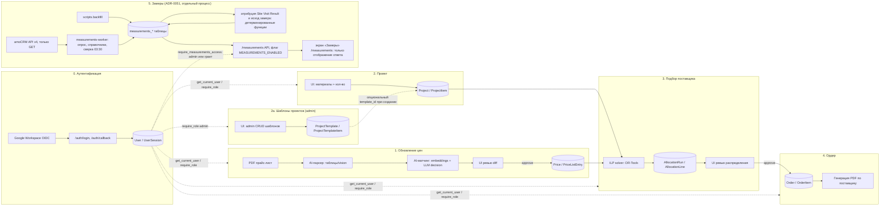

# Архитектура

Актуализируй эту диаграмму при каждом значимом структурном изменении — это основной
"граф знаний" проекта, читаемый и человеком, и Claude Code в начале сессии.

## Границы модулей

- **Auth** — Google Workspace OIDC (authorization code + PKCE), сессии в БД
  (`UserSession`), не JWT — см. `docs/decisions/0024-authentication-authorization.md`.
  Единственный источник identity/роли для всех остальных модулей.
- **Ingestion** — единственное место, где решения принимает LLM без гарантии
  правильности; поэтому всегда с человеческим ревью перед записью в `Price`.
- **Templates** — справочные данные (кто может создавать/редактировать шаблоны —
  `admin`, как `Supplier`/`Material`), применяются только опционально в момент
  создания `Project`, не архитектурная часть модуля 2. См.
  `docs/decisions/0032-project-templates.md`.
- **Allocation** — детерминированный сервис, без вызовов LLM. См. ADR по алгоритму.
- **Order generation** — чистая шаблонизация, без бизнес-логики.

Все 11 бизнес-роутеров (`supplier`/`material`/`category`/`price`/`price_ingestion`/
`template`/`project`/`allocation`/`order`/`purchase_record` + `/users`)
защищены на уровне `APIRouter(dependencies=[...])` — `require_role("admin")`
для справочных данных (`supplier`/`material`/`category`/`price`/`price_ingestion`/
`template`/`users`), `get_current_user` (любая роль) для операционной работы
(`project`/`allocation`/`order`/`purchase_record`) — см. ADR-0024 §4/§5,
ADR-0032 §2. `category` (`/categories`) — справочник категорий материала
(`Category`), заменяет хардкод-константу `STRICT_CATEGORIES` управляемым
через БД полем `requires_single_supplier`, и выдаёт `internal_sku` новым
материалам атомарно — см. `docs/decisions/0034-material-category-entity-and-sku-autogeneration.md`.
`health.py` остаётся публичным; `auth.py` смешанный (публичные `/login`,
`/callback`, защищённые `/me`, `/logout`).

- **Матрица цен** (`app/services/price_matrix.py`, ADR-0054) — только чтение
  `Price`: `GET /prices/matrix` (материалы × поставщики, сравнение с предыдущей
  версией или с датой, «давно не обновлялся») и `GET /prices/history` (версии
  пары с источником). Под admin-роутером `/prices`. Экран — `/prices`
  (`frontend/src/routes/price-matrix/`).

- **Measurements** (`backend/app/measurements/`, ADR-0051) — изолированный
  модуль: логику закупок не импортирует, таблицы с префиксом `measurements_`.
  Данные читаются из amoCRM только GET-запросами отдельным процессом
  `measurements-worker` (свой engine на 2 соединения, единственность через
  `pg_try_advisory_lock`, общий с бэкфиллом). Роутер `/measurements`
  подключается в `main.py`, только если `MEASUREMENTS_ENABLED=true`; при
  выключенном флаге загружаются лишь `app.measurements.flags` и
  `app.measurements.models`. Доступ — третья категория к ADR-0024 §4:
  `require_measurements_access` (активный `admin` или грант в
  `measurements_user_access`), а не значение `User.role`. Привязка результата
  Site Visit Result к замеру — чистая функция `attribution.attribute`, без LLM.
  Исход и группа дублей замера (ADR-0053) — чистая функция
  `outcomes.compute_outcomes`; её строки (`measurements_visit_outcomes`)
  пересчитываются вместе с атрибуциями потоком `attribution`, сверкой (в том
  числе при сработавшем предохранителе), бэкфиллом и скриптом `recompute`.
  Таймзона модуля — константа `app.measurements.zone`, не настройка.
  Метрики (ADR-0053) — `metrics.py`: SQL через SQLAlchemy Core по
  `measurements_visit_outcomes` с соединением на `measurements_visits`, отношения
  в `Decimal`; маршруты `GET /measurements/metrics` и `/metrics/visits` в том же
  роутере, под тем же `require_measurements_access`, только агрегаты и
  идентификаторы. Экран — `frontend/src/routes/measurements/` (страницы
  `/measurements` и `/measurements/visits`). Он ничего не считает, кроме
  пиксельной высоты столбиков графика. Пункт меню показывается по
  `GET /measurements/access` (`useMeasurementsAccess`), а не по роли
  (`docs/ui-reference.md` §9).

## Связанные документы

- Данные: `docs/data-model.md`
- Решения: `docs/decisions/`
- Термины: `docs/glossary.md`
